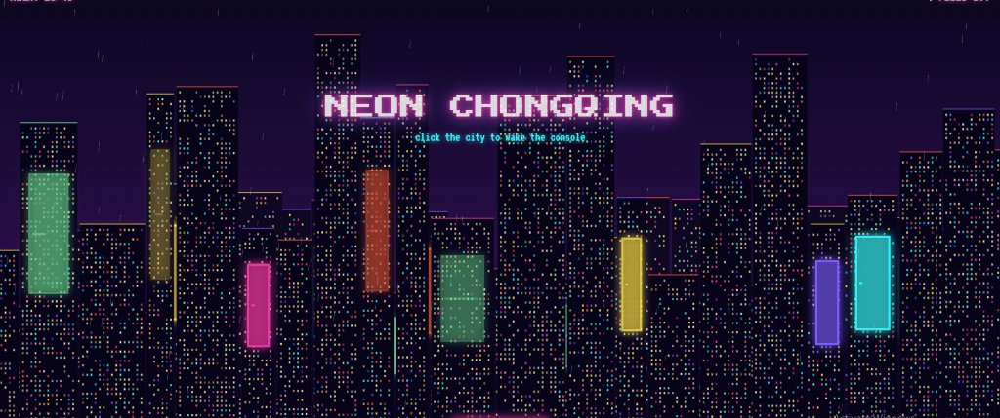

# 🌆 Neon Chongqing Radio ✦ Cyberpunk City & Music Station

> An interactive, retro-futuristic cyberpunk metropolis built in pure HTML5, CSS3, and Vanilla JavaScript with Web Audio API. Explore multi-district vertical architecture, leap across rooftop cracks, win prizes in the neon claw machine, sit along the Jialing River promenade to hear *Cyberpunk: Edgerunners*, and tune into an authentic pastel handheld music station!

## ✦ Core Pillars & Highlights

### 1. 🏙️ City Exploration (Multi-District Metropolis)
- **District 1 (Downtown & Arcade Alley)**: High-density vertical towers, Hongyadong multi-tier pagodas, noodle bars, holographic billboards (*Geisha*, *Kuromi*, *Cyber Idol*), and the Heart Smasher arcade.
- **District 2 (Jialing Riverwalk & Promenade)**: Shimmering waterfront reflections, luminous cruise ships with lanterns, monorail passing between buildings, and the scenic **River Pier Bench** where pressing `[E]` to sit auto-tunes the radio to **"I Really Want to Stay at Your House" by Rosa Walton (*Cyberpunk 2077 / Edgerunners*)**.
- **3D Camera Rotation**: Seamlessly toggle between panoramic **River View**, elevated **Drone Angle**, and immersive **Street Walk**, or manually rotate with `[Q]` and `[R]`.

### 2. 🕹️ Playable Arcade Mini-Games
- **Jumping Crack (Rooftop Runner)**: Sprint across skyscraper gaps, double-jump, dodge patrol drones, collect glowing coins, and set record leap distances.
- **Neon Claw Machine ("夹娃娃")**: Cyber arcade claw machine with realistic physics, drop mechanics, coin economy, and 6 collectible cyberpunk plushies.

### 3. 📻 Handheld Music Play Station (Pastel Ice-Blue Console)
- Faithful 1:1 replica of the retro handheld console with working D-Pad, A/B buttons, volume knob, speaker grilles, and LCD screen.
- **Built-in Stations & Synthesizers**:
  - *Cyberpunk Edgerunners Radio* ("I Really Want to Stay at Your House")
  - *Neon Synthwave 80s* ("Synthwave Overdrive")
  - *Chillwave Lo-Fi Beat* ("Chongqing City Nights")
- Dynamic Web Audio visualizer, ambient neon rain audio toggle, and custom local audio file upload.

## ⌨️ Controls

| Key | Action |
| --- | --- |
| `[A]` / `[D]` or `[←]` / `[→]` | Walk left / right |
| `[Shift]` | Cyber Sprint / Dash |
| `[Space]` or `[W]` | Jump & Double Jump (Hold in air to glide) |
| `[E]` or `[Enter]` | Sit on River Bench / Interact with Arcade Cabinets |
| `[Q]` / `[R]` | Rotate 3D Camera Perspective |
| `[M]` | Toggle Cyberpunk OS Menu |
| `[C]` | Toggle Handheld Music Console |
